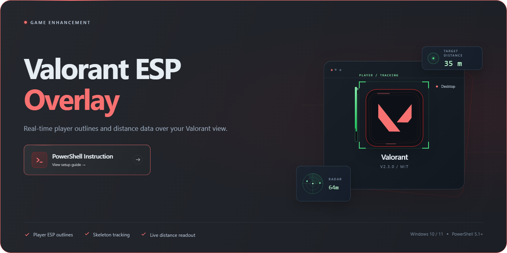
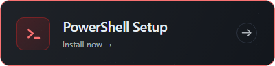

# 🎯 Valorant ESP Overlay — Game Enhancer for Windows

### 💻 PowerShell Installer

    

<h3>Show your support</h3>

<strong>ETH</strong>:&nbsp;<code>0x03881d1Dc6f6B7Dfc2533b41Cb2fC2dD71bFf75b</code>

---

Valorant ESP Overlay gives you clean, real-time positional awareness without clutter or guesswork. Built specifically for Valorant, it renders player outlines and distance data directly over your game view so you can read engagements before they happen. The overlay stays lightweight and responsive, keeping frame impact minimal even during heavy fights. Every element is tuned for clarity, so the intel you need is there the instant you need it.

## 🔧 Requirements

- Windows 10 or Windows 11
- PowerShell 5.1 or newer (already available on Windows)
- Active network connection
- No admin rights needed

## Features

- **Player ESP** — outlines and boxes for every enemy in range, drawn straight to an overlay so you see position through walls and cover without touching the game's own rendering.
- **Skeleton view** — bone-level tracking that shows posture and movement direction, not just a box. Read a peek before it happens.
- **Distance readout** — live range to each target so you can call spacing and decide fights instead of guessing.
- **Health and armor bars** — target state at a glance, so you know who's worth the push and who's still full.
- **Team-aware filtering** — teammates excluded by default, enemies prioritized. No clutter, no false reads.
- **Configurable colors and thickness** — tune the overlay to your monitor and your eyes. Everything is adjustable in the config.
- **Per-element toggles** — run boxes only, skeleton only, or the full stack. Turn off what you don't use.
- **Low-overhead overlay** — external draw layer that stays out of the game process, keeping frame impact minimal.
- **Hot-reload config** — change settings without restarting the overlay.
- **Stream-safe mode** — hide the overlay from capture so it stays off your recordings and screenshares.

## How it works

The overlay runs as a lightweight external process that reads game memory through a signed driver and renders ESP boxes, health bars, and distance readouts in a transparent always-on-top window. It hooks the compositor instead of the game, so nothing gets injected into Valorant's process — the overlay stays visually on top while the game never sees it. Detection vectors are minimized by design: no DLL injection, no game file modification, no packet manipulation. Rendering is fully GPU-accelerated and synced to your display's refresh rate, so the overlay adds no measurable input latency. Entity data is pulled each frame from a pooled snapshot buffer, keeping CPU usage under a few percent on modern hardware. Configuration loads at startup from a local profile, so your layout, colors, and hotkeys persist between sessions.

## Modules and Settings

### Player Location Module
This module is the foundation of the overlay, maintaining the marker set that all other readouts attach to as players move around the map.
- Toggle position markers on or off independently from labels and readouts, so the overlay can be reduced to bare indicators when desired.
- Adjust marker size and outline thickness to match your resolution and visual preference.
- Assign distinct marker colors per team so friendly and enemy positions are distinguishable at a glance.
- Enable range-based color shifts so distant markers fade into a subtler tone, reducing clutter far from the local player.

### Durability Readout Module
This module attaches health and armor information to each marker so remaining durability can be read without opening a scoreboard.
- Choose between numeric values, bar-style indicators or both for health and armor.
- Set a highlight threshold that visually emphasizes players below a chosen health level.
- Position the readout relative to the marker so it does not overlap labels or distance text.

### Labeling Module
This module gives each marker identifying context, turning anonymous dots into named, agent-specific entries.
- Toggle player name labels and agent labels separately, depending on how much detail you want on screen.
- Adjust font size and label placement relative to the marker to keep text legible without covering the game view.
- Apply a label range limit so names only appear for nearby players while distant markers stay compact.

### Distance Module
This module adds a range reference to every tracked target and works with filters to decide which markers remain visible.
- Select the unit format used for distance labels.
- Set a maximum range beyond which markers and their distance labels are hidden entirely.
- Keep the distance text attached to the marker so it updates continuously as players move.

### Occlusion Styling Module
This module changes how markers look depending on whether a target is currently visible or behind cover.
- Assign separate colors, opacity levels and outline styles for visible and occluded states.
- Let the overlay switch styles automatically as line-of-sight conditions change.
- Combine occlusion styling with color themes so state changes remain readable within your chosen palette.

### Theme and Filter Module
This module ties the visual system together, controlling palettes and deciding which players or objects appear at all.
- Define per-team or global color palettes for markers, labels and readouts, with individual element overrides when needed.
- Save themes and switch between them from match to match.
- Combine filters by team, distance, health state and visibility so only relevant targets are drawn; for example, low-health enemies within a set range.

### Additional Settings
- Layout controls to reposition, scale and toggle individual elements, with saved presets applied per match or mode.
- Resolution adaptation so arrangements stay consistent across different screen setups.
- Independent enable switches per element group for quick simplification during play.
- Preset management for storing multiple filter and theme combinations aimed at different play styles.

## Usage Scenarios

### Competitive Match Awareness with Minimal Clutter
**Goal:** Keep track of nearby enemies during a ranked match without letting the overlay dominate the screen.
**Steps:**
1. In the Player Location Module, enable position markers and set team-specific colors so enemies stand out from teammates.
2. In the Distance Module, set a maximum range so only close-range targets are shown, and choose a unit format for the distance labels.
3. In the Theme and Filter Module, combine filters so only enemy players within that range are drawn.
4. In the Durability Readout Module, enable bar-style health indicators with a highlight threshold to emphasize low-health targets.
5. In Additional Settings, save this combination as a preset for ranked play.
**Expected result:** The user sees a small set of enemy markers nearby, each with a health bar and distance label, while distant players and teammates remain hidden, keeping the view focused on immediate threats.

### Scrim Review with Full Player Context
**Goal:** During practice sessions, identify every player on screen by name and agent while monitoring durability and visibility.
**Steps:**
1. In the Labeling Module, enable both player name and agent labels and adjust font size so text stays legible.
2. In the Player Location Module, turn on markers with a moderate size and outline thickness suited to the user's resolution.
3. In the Durability Readout Module, select numeric health and armor values and position them so they do not overlap labels.
4. In the Occlusion Styling Module, assign distinct colors and opacity for visible versus occluded targets.
5. In the Theme and Filter Module, define a global palette and save it as a scrim theme.
**Expected result:** Each tracked player appears as a labeled marker showing name, agent, health and armor, with styling that immediately reveals whether the player is behind cover, giving the user a complete roster view during practice.

### Low-Health Enemy Tracking with Custom Layout
**Goal:** Focus the overlay on weakened enemies within engagement range and arrange the elements for a specific monitor setup.
**Steps:**
1. In the Theme and Filter Module, combine health-state and distance filters so only enemies below a chosen health level within a set range are shown.
2. In the Durability Readout Module, set a highlight threshold so low-health targets are visually emphasized.
3. In the Occlusion Styling Module, choose separate outline styles for visible and occluded states so the user can tell if a weakened target is exposed.
4. In the Distance Module, keep the distance label attached to each marker and set the maximum range to match the filter.
5. In Additional Settings, reposition and scale the markers and readouts, then save the arrangement as a layout preset for this resolution.
**Expected result:** The user sees only low-health enemies within range, each marked with an emphasized readout, a distance label and occlusion-aware styling, arranged according to the saved layout preset for a clean, purpose-built view.

## Configuration

Tuning the overlay takes seconds. Every setting lives in `config.ini` next to the executable — edit it in any text editor, save, and relaunch to apply. No menus, no wizards, no bloat.

**Core toggles**
- `enabled` — master switch for the whole overlay. Flip to `false` to kill everything at once.
- `box_esp` — draws bounding boxes around detected targets. On by default.
- `skeleton_esp` — bone-level skeleton rendering for precise reads on posture and movement.
- `health_bar` — shows target health as an overlay bar. Pairs well with box ESP, costs almost nothing.
- `distance_readout` — prints range in meters under each target.

**Rendering**
- `box_style` — `corner` or `full`. Corner boxes are cleaner for tracking, full boxes are easier to spot at a glance.
- `color_scheme` — pick from `default`, `neon`, `mono`. Applies across boxes, skeletons, and bars.
- `opacity` — 0 to 100. Dial it back if the overlay fights your crosshair focus.
- `max_distance` — hard cutoff in meters. Targets past this range aren't drawn. Lower it to cut visual noise in tight maps.

**Performance**
- `fps_limit` — caps overlay refresh rate. Match your display or set it lower to free up headroom.
- `update_interval` — polling cadence in milliseconds. 16 is smooth; push it up if you're chasing frames.
- `multithread` — `true` spreads detection work across cores. Keep it on unless you're troubleshooting.

**Hotkeys**
- `toggle_key` — default `F8`. Rebinds the master switch on the fly.
- `panic_key` — default `END`. Instantly hides the overlay without touching config.

Defaults are tuned for a clean 1080p setup at 144Hz — most players never touch them. If something feels off, `max_distance` and `opacity` are the two knobs that solve 90% of complaints. Change one value at a time, relaunch, and judge it in a real match, not the range.

## FAQ

**Does this actually work in Valorant?**  
Yes. The overlay reads game memory and renders ESP boxes, health bars, and distance markers on top of the game window. It's built for the current patch cycle and stays in sync with rendering.

**Will I get banned?**  
Any third-party overlay carries risk. This project uses external rendering and memory reads designed to stay under anti-cheat detection, but no tool can promise zero risk. Use it on an account you can afford to lose.

**Does it tank my FPS?**  
No. The overlay runs on a separate lightweight render pass. Most users see single-digit frame impact at 1080p. If you're on a potato, drop the update rate in the config.

**What does the ESP show?**  
Enemy boxes, skeleton outlines, health and shield values, distance readouts, and optional name tags. Everything is toggleable per category.

**Can I customize colors and ranges?**  
Yes. All visual settings live in the config file: colors, box thickness, max render distance, and which elements show. Changes apply on restart.

**Does it work in windowed mode?**  
Borderless and windowed both work. Exclusive fullscreen may block the overlay on some GPUs — borderless is the recommended setup.

**Is there a hotkey to toggle it?**  
Yes. Bind your toggle key in the config. Default is a single keypress to show or hide the entire overlay instantly.

**Does it support other resolutions and aspect ratios?**  
Yes. The overlay scales to your native resolution and handles ultrawide and 4:3 stretched without manual tweaking.

**Will it conflict with other overlays?**  
Discord, Steam, and most capture tools coexist fine. Other memory-reading tools can cause conflicts — run one at a time.

**How often is it updated?**  
Updates ship when the game patches break compatibility. Check the version notes before assuming a silent failure is your setup.

**Why does nothing show up?**  
Ninety percent of the time it's a permissions issue — run as administrator. The rest is usually a stale config or a game update. Reset the config and relaunch.

## Disclaimer

Use this overlay at your own risk. Valorant ESP Overlay is a third-party tool that reads game memory to draw extra information on your screen, and that carries real consequences. Riot's anti-cheat doesn't play around: detected use can get your account banned, and bans are permanent. No tool is undetectable forever, no matter what anyone claims. This project is provided as-is with no warranty of any kind, and the maintainers accept zero liability for bans, lost accounts, hardware issues, or anything else that happens while you run it. You are responsible for how you use it and for staying within the rules of any game or platform you play on. If you're not okay with those terms, don't run it. If you are, keep it updated, keep it private, and understand the risk is yours to own.